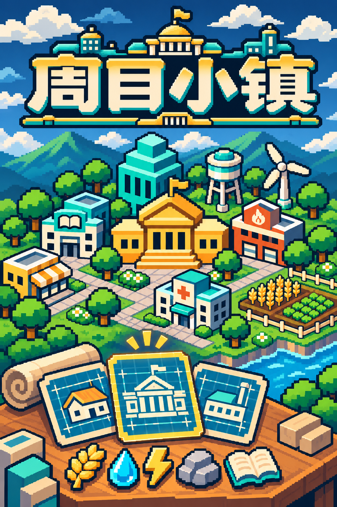

# 周目小镇 · 竖版封面



- 文件：`loop-town-cover-portrait-1024x1536.png`，PNG，1024 × 1536，2:3 竖版。
- 符合最低 600 × 900 的尺寸要求；图中包含游戏名称 LOGO 与标题「周目小镇」，没有标题以外的宣传文字。
- 延续已有名称 LOGO、像素建筑、蓝图与资源图标的视觉主题，重新绘制竖版构图；不是从横版裁切。
- 生成方式：OpenAI 内置 imagegen。参考现有名称 LOGO 和横版宣传图。原始生成文件直接复制入项目，未追加文字、裁切或调整图像。
- 上传副本：工作区 `outputs/loop-town-cover-portrait/loop-town-cover-portrait-1024x1536.png`。

## 最终生成提示词

```text
Use case: ads-marketing.
Asset type: ONE finished portrait storefront game cover illustration for the Chinese resource-management and town-building strategy game “周目小镇”.
Canvas: vertical 2:3 composition, target 1024 × 1536 pixels or larger, opaque full-bleed PNG. Deliver only the finished cover, no upload form or presentation mockup.

Input images:
Image 1 is the existing transparent game wordmark: use it as the strict brand identity and Chinese lettering reference.
Image 2 is the existing landscape promotional art: style, architecture, palette and planning-board theme reference only. Create a newly composed VERTICAL artwork; do not crop the landscape into a portrait and do not paste screenshots.

Primary request:
Create a richly illustrated, crisp COARSE PIXEL ART vertical game cover. Include the recognizable illustrated name LOGO from image 1 and the exact game title “周目小镇”. They can be one integrated name logo, shown once. The ONLY writing anywhere on the whole cover must be these four Chinese characters in this exact order: 周 / 目 / 小 / 镇. The second character is 目, not 日. Preserve legible, accurate simplified Chinese letterforms. No tagline, subtitle, English, numbers, watermark, labels, menus or other writing.

Composition:
Recompose for a tall 2:3 cover with a strong top-to-bottom hierarchy. Across the upper quarter, place a large readable horizontal “周目小镇” wordmark with warm ivory/gold chunky pixel faces, teal side shadows and deep navy stepped outline, crowned by the small civic hall and teal roof details of the existing logo. Leave a modest safe inset around all title strokes so no text clips. The cover remains fully illustrated around and behind the logo, no blank panel.
Below and around the title, show a modest tiered town cluster: golden civic hall as a focal building, a teal-and-ivory school with an open-book emblem, simple utility buildings, a water tower, one wind turbine, and a small wheat field. Connect them with short paths, blocky trees and a small river edge. Keep the architectural motifs and proportions close to image 2.
The lower foreground is a town-planning desk with THREE illustrated building blueprint cards, integrated naturally in the same pixel-art scene. The cards show simple building drawings and blueprint grid lines without any writing. Integrate a few large readable resource tokens such as wheat, a water droplet, lightning and an open book near the blueprints. Fill the canvas to the edges with the coherent scene; give the image generous visual content, clear hierarchy and a clean silhouette. It should communicate choosing blueprints, providing resources and building a small town, faithful to a card-based resource strategy game.

Style / mood:
Authentic coarse 16-bit pixel art with very visible square pixels, crisp stepped contours and limited flat shading. Match the existing game's pixel brand style closely. Deep navy and slate blue, bright teal, warm gold and ivory, restrained crop and tree green. Inviting and thoughtful strategy-game mood. Readable as a small storefront thumbnail. A cohesive illustration, not a collage or a screenshot.

Strict avoid:
Any text other than “周目小镇”; slogans, advertising copy, badges, numbers, lettering on blueprint cards or buildings; app-icon tiles, extra logos, phone/device frames, UI, fake gameplay screenshots, borders or blank margins; photographic rendering, smooth vector-style edges, glossy 3D; fantasy castles, combat, mascots, vehicles or other unsupported game features.
```
