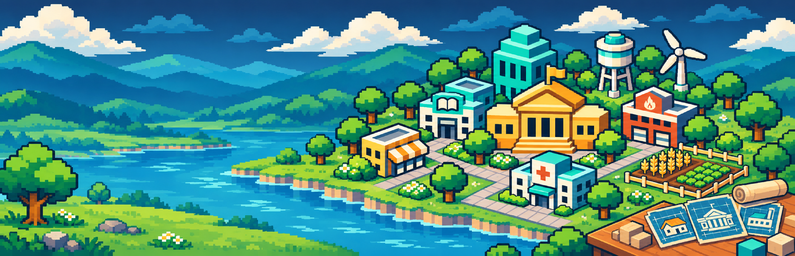

# 周目小镇 · PC 游戏库背景壁纸



- 上传文件：`loop-town-library-background-3840x1240.png`，3840 × 1240，PNG，3,760,936 字节（约 3.76 MB），小于 10 MB。
- 不含游戏 LOGO、标题、宣传文字、水印或其他文字内容。
- 左侧约 42% 以湖面、草地和远山为主，预留公告及活动卡片可能覆盖的区域；小镇和主要建筑集中在中右侧。
- 延续既有像素建筑、蓝图和资源经营主题；没有增加游戏 UI、卡片占位或设备边框。
- 使用 OpenAI 内置 imagegen，参考既有横版宣传图的建筑、配色及像素风格，重新生成无标题的超宽构图。
- 工具原图为 2206 × 713。上传文件仅进行最近邻尺寸导出至 3840 × 1240，以保持像素轮廓；没有追加文字、裁切或改动构图。原图保存在工作区 `outputs/loop-town-library-background/loop-town-library-background-original.png`。
- 上传副本位于工作区 `outputs/loop-town-library-background/loop-town-library-background-3840x1240.png`。
- 尺寸导出脚本：工作区 `work/export-loop-wallpaper.ps1`。

## 最终生成提示词

```text
Use case: stylized-concept.
Asset type: finished ultra-wide PC game-library BACKGROUND WALLPAPER for the pixel-art town-planning strategy game represented by the reference.
Canvas: ultra-wide panoramic 96:31 aspect ratio, target EXACTLY 3840 × 1240 pixels, full-bleed opaque landscape, high-definition PNG. One cohesive panoramic illustration, no border.

Input image 1: use ONLY as an art-style, building-design and palette reference. Its Chinese title and name logo MUST NOT appear in the new artwork. Do not reproduce any of its writing or branding.

Primary request:
Create an original beautiful panoramic pixel-art background with NO GAME LOGO and NO TEXT OF ANY KIND. Show the same modest town-building world: warm ivory walls, teal roofs and utility buildings, a golden civic hall, a school with a simple open-book pictogram, a water tower, one wind turbine, a small clinic and farmland. Recompose everything for a spacious ultra-wide wallpaper rather than a cover poster.

Critical UI-safe layout:
The LEFT 42% of the whole image will potentially be covered by announcement and activity cards. Keep this left area visually quiet, lower in contrast and populated ONLY by nonessential environment: layered blue/teal distant hills, a calm river or lakeshore, broad grass and a few small peripheral trees. Do not place any important buildings, focal objects, blueprint cards, large icons or characters in the left 42%.
Put the main small-town architectural cluster in the CENTER-RIGHT and RIGHT, concentrated between 55% and 90% of image width. The golden civic hall is the clear main subject around 67% width, surrounded by the teal-and-ivory school, utility buildings, water tower, wind turbine and a small wheat/vegetable patch. Short paved paths and blocky trees connect the town. Keep all major architectural silhouettes fully visible with breathing room at the top and bottom. Extend scenery naturally across the entire wide frame. The quiet left side must still be actual illustrated scenery, never an empty flat panel, placeholder or unpainted gradient.
A small foreground planning desk and a few building-blueprint sheets may be integrated at the far lower RIGHT as secondary details, with ONLY building drawings and grid lines, absolutely no writing or numbers. Keep it restrained so this reads primarily as a background environment.

Art direction:
Match the supplied illustration's authentic coarse 16-bit pixel art: clearly visible square pixel blocks, stepped edges, clean silhouettes and limited crisp flat shading. Deep navy and slate blues, turquoise and teal, warm gold/ivory buildings and restrained greens. A calm, inviting afternoon light with luminous gold architectural accents and clear scenic depth. Use layered pixel shapes instead of smooth gradients, painterly brushwork or photographic blur. The town should be modest and coherent, not a huge metropolis or a different genre.
The right town should remain an attractive focal scene if the left region is obscured. No important content hidden behind the expected left-side UI.

Text: NONE.
Strict avoid: Chinese or English words, letters, numbers, title lettering, logos, wordmarks, app icons, slogans, watermarks, signatures, labels, street signs, fake text on cards/buildings, game UI, announcement cards or UI mockups, device frames, borders, screenshots; people/mascots, combat, fantasy castles, huge futuristic cities, vehicles, photorealism, smooth vector graphics or glossy 3D.
```
